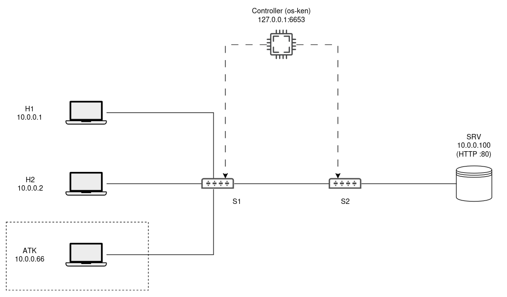

# Firewall sterowany przez SDN z dynamicznym zarządzaniem regułami OpenFlow

# Opis

Celem projektu jest wdrożenie sterownika implementującego firewall dynamicznie zarządzającego regułami OpenFlow, ze szczególnym uwzględnieniem ataków TCP (np. klasyczny `SYN_ACK`). Podstawowy scenariusz będzie zakładać topologię z niegroźnymi stacjami, jednym atakującym, dwoma przełącznikami i serwerem. Zadaniem firewalla będzie monitorowanie sesji TCP i reakcja na podejrzany lub widocznie groźny ruch.

Korzystamy z `os-ken` (3.1.1) jako kontrolera SDN (Python), a z `mininet` jako emulatora sieci (również Python) -- jego zostawiamy na poziomie systemu hosta.

# Uruchomienie
Budowane na Linux Mint:
1. Jednorazowo: `sudo apt update && sudo apt install -y mininet openvswitch-switch python3-venv`
2. Każdorazowo, gdy brakuje venva: `cd ./src && ./setup.sh`
3. Do odpalenia kontrolera *osken*: `./run_controller.sh </path/to/controller.py>` -- należy to zrobić przed odpaleniem emulacji sieci, w jednym terminalu (lub z `&`)
4. Do odpalenia emulatora *mininet* z topologią: `./run_topo.sh` \[wymaga sudo] -- warto odpalić w drugim terminalu

# Topologia

# Skład zespołu
- Agnieszka Dańda
- Agata Marczyk
- Kamil Drożdż
- Jan Krzyszkowski
- Stanisław Niemczewski

# Literatura
1. Zerkane, S., Espes, D., Le Parc, P., Cuppens, F. (2016). Software Defined Networking Reactive Stateful Firewall. In: Hoepman, JH., Katzenbeisser, S. (eds) ICT Systems Security and Privacy Protection. SEC 2016. IFIP Advances in Information and Communication Technology, vol 471. Springer, Cham. https://doi.org/10.1007/978-3-319-33630-5_9
	- propozycja metody do wdrożenia -- w skrócie: reaktywne kontrolowanie sesji TCP i na tej podstawie przepuszczanie jedynie ustawionych sesji TCP (np. odrzucanie samego SYN\_ACK, ubijanie sesji widmo)
2. S. Kim, S. Yoon, J. Narantuya and H. Lim, "Secure Collecting, Optimizing, and Deploying of Firewall Rules in Software-Defined Networks," in IEEE Access, vol. 8, pp. 15166-15177, 2020, doi: 10.1109/ACCESS.2020.2967503.
	- o wdrażaniu reguł OpenFlow dla firewalla
3. *być może dodatkowo:* Hu, Han, Ahn, Zhao (2014), FlowGuard: Building Robust Firewalls for Software-Defined Networks HotSDN 2014 (ACM), DOI: 10.1145/2620728.2620749
	- opis problemów, które możemy napotkać, dot. dynamicznych zmian reguł, wybór architektury do tego celu, itp.
